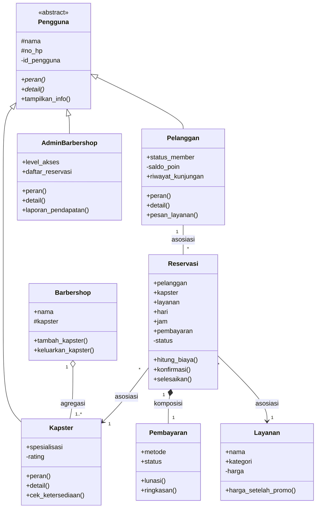

**Nama:** Muhammad Ancel Prinata
**NIM:** 2509106099
**Kelas:** C1'25
## Penjelasan Program

Program ini merupakan pembaruan dari sistem reservasi jadwal potong rambut RapiJaya Barbershop. Pada versi sebelumnya program sudah memakai pewarisan. Pada versi ini ditambahkan **relasi antar kelas (asosiasi, agregasi, komposisi), abstraksi (Abstract Base Class), dan polimorfisme** (override method, duck typing, dan operator overloading).

Alur pengujian berupa blok simulasi otomatis di `__main__`: pendaftaran kapster dan layanan, simulasi reservasi pelanggan, pengaturan promo, sampai laporan pendapatan admin, tanpa input manual di terminal.

## Fitur

- **Kelola Layanan & Promo:** menambah layanan, mengubah harga dengan validasi, menghapus layanan, dan mengatur diskon promo global.
- **Manajemen Kapster:** menyimpan data kapster (nama, spesialisasi, rating), mengelola jadwal terisi, dan mengatur hari libur.
- **Simulasi Reservasi:** validasi hari, format jam HH:MM, metode pembayaran, dan ketersediaan slot kapster, lalu mencetak struk otomatis.
- **Sistem Poin & Keanggotaan:** poin dari kunjungan yang selesai dapat menaikkan status pelanggan menjadi VIP (diskon 10%).
- **Notifikasi Multi-Kanal:** pengingat jadwal dikirim lewat WhatsApp dan SMS (duck typing).
- **Dashboard Admin:** mengubah jam operasional, menetapkan hari libur kapster, melihat data dan riwayat pelanggan, dan laporan pendapatan transaksi lunas.

## Cara Menjalankan

1. Pastikan Python 3 sudah terinstal.
2. Buka terminal, arahkan ke folder tempat file berada.
3. Jalankan perintah:

```bash
python barbershop.py
```

4. Seluruh simulasi berjalan otomatis dan hasilnya tampil di terminal (contoh ada di bagian **Output Program**).

---

## 1. Relasi UML (Class Diagram)


Versi yang sama dalam bentuk kode Mermaid (otomatis tergambar di GitHub):



**Asosiasi: `Reservasi` ke `Layanan`** (juga `Reservasi` ke `Kapster`, dan `Pelanggan` 1 --- * `Reservasi`)
`Reservasi` hanya mengenal objek `Layanan`, `Kapster`, dan `Pelanggan` yang dikirim lewat parameter `__init__` (`self.layanan = layanan`). Ketiganya tetap ada dan bisa dipakai reservasi lain kalau satu reservasi dihapus, jadi hubungannya hanya "terhubung", bukan "memiliki".

**Agregasi: `Barbershop` o-- `Kapster`**
`Barbershop` menyimpan daftar kapster di `self._kapster` lewat `tambah_kapster()`, tetapi objek `Kapster` dibuat di luar `Barbershop`. Dipilih agregasi karena kapster bisa berdiri sendiri: setelah `del shop`, objek `kapster1`, `kapster2`, dan `kapster3` tetap hidup (terlihat di output).

**Komposisi: `Reservasi` *-- `Pembayaran`**
Objek `Pembayaran` dibuat di dalam `Reservasi.__init__` (`self.pembayaran = Pembayaran(metode_pembayaran)`) dan tidak dipakai di tempat lain. Dipilih komposisi karena pembayaran tidak punya arti tanpa reservasinya, jadi siklus hidupnya terikat pada reservasi.

Pewarisan dari posttest sebelumnya tetap dipakai: `Pengguna` diwarisi oleh `Kapster`, `Pelanggan`, dan `AdminBarbershop`, lengkap dengan `super().__init__()`, atribut unik tiap subclass, serta atribut protected (`_nama`) dan private (`__id_pengguna`, `__rating`, `__saldo_poin`).

---

## 2. Abstraksi (Abstract Base Class)

| Syarat | Implementasi di kode |
|---|---|
| Abstract class (ABC) | `class Pengguna(ABC)` |
| Minimal 2 `@abstractmethod` | `peran()` dan `detail()` |
| Minimal 2 subclass mengimplementasikan semua abstract method | `Kapster`, `Pelanggan`, dan `AdminBarbershop` |
| Minimal 1 method konkret dipakai bersama | `tampilkan_info()`: alur yang sama untuk semua pengguna, memanggil `peran()` dan `detail()` milik tiap objek |

Bukti abstract class tidak bisa diinstansiasi:

```python
try:
    orang = Pengguna("Tanpa Peran", "081200000000")
except TypeError as e:
    print(f"Error: {e}")
```

Output:

```
Error: Can't instantiate abstract class Pengguna without an implementation for abstract methods 'detail', 'peran'
```

---

## 3. Polimorfisme

**a. Polimorfisme via pewarisan.** `peran()` dan `detail()` di-override oleh tiga subclass dengan perilaku berbeda, dipanggil lewat satu loop:

```python
semua_pengguna = [kapster1, p1, admin]
for pengguna in semua_pengguna:
    pengguna.tampilkan_info()
```

**b. Duck typing.** `NotifWhatsApp` dan `NotifSMS` tidak berhubungan lewat pewarisan, tetapi sama-sama punya `kirim(pesan)` dan dipanggil lewat satu fungsi:

```python
def kirim_ke_semua(kanal_list, pesan):
    for kanal in kanal_list:
        kanal.kirim(pesan)
```

**c. Operator overloading.**

| Kelas | Magic method | Kegunaan |
|---|---|---|
| `Pengguna` | `__str__` | `print(kapster1)` menampilkan `Kapster Andi (USR001)` |
| `Layanan` | `__str__`, `__lt__`, `__add__` | tampilan layanan, `sorted()` dan `max()` otomatis, `layanan1 + layanan3` = total harga |
| `Barbershop` | `__len__`, `__str__` | `len(shop)` = jumlah kapster |

**d. Tanpa anti-pattern.** Tidak ada `if/elif` yang mengecek `type()` atau string jenis. Perilaku dibedakan lewat method tiap kelas. Diskon member memakai dictionary `diskon_member_persen`, dan status awal pembayaran memakai dictionary `status_awal`.

---

## Struktur Kelas

### 1. Pengguna (Abstract Class)
- **Atribut:** `_nama` (protected), `_no_hp` (protected), `__id_pengguna` (private, lewat properti), `total_pengguna` (kelas)
- **Abstract method:** `peran()`, `detail()`
- **Method konkret:** `tampilkan_info()`
- **Magic method:** `__str__()`
- **Method statis:** `validasi_no_hp()`

### 2. Layanan
- **Atribut:** `nama`, `kategori`, `harga` (private, lewat properti), `kategori_valid` (kelas), `registry` (kelas), `diskon_promo_persen` (kelas)
- **Method:** `harga_setelah_promo()`, `tampilkan()`
- **Magic method:** `__str__()`, `__lt__()`, `__add__()`
- **Method kelas:** `tambah_layanan()`, `ubah_harga()`, `hapus_layanan()`, `set_promo()`, `daftar_semua()`
- **Method statis:** `validasi_harga()`

### 3. Kapster (turunan Pengguna)
- **Atribut:** `spesialisasi`, `jadwal_terisi`, `hari_libur`, `rating` (private, lewat properti), `nama_barbershop` (kelas), `jam_operasional` (kelas), `total_kapster` (kelas)
- **Method:** `peran()`, `detail()`, `layani_pelanggan()`, `tambah_jadwal()`, `tambah_hari_libur()`, `cek_ketersediaan()`, `slot_kosong()`
- **Method kelas:** `dari_dict()`, `ubah_jam_operasional()`
- **Method statis:** `generate_slot_jam()`

### 4. Pelanggan (turunan Pengguna)
- **Atribut:** `status_member`, `preferensi_gaya`, `riwayat_kunjungan`, `saldo_poin` (private, lewat properti), `total_pelanggan` (kelas), `syarat_poin_redeem` (kelas), `member_default` (kelas), `diskon_member_persen` (kelas)
- **Method:** `peran()`, `detail()`, `diskon_member()`, `tambah_poin()`, `pesan_layanan()`, `catat_kunjungan()`, `tampilkan_riwayat()`
- **Method kelas:** `dari_dict()`, `ubah_syarat_poin_redeem()`

### 5. Pembayaran
- **Atribut:** `metode`, `status`, `metode_valid` (kelas), `status_awal` (kelas)
- **Method:** `lunasi()`, `ringkasan()`

### 6. Reservasi
- **Atribut:** `pelanggan`, `kapster`, `layanan`, `hari`, `jam`, `pembayaran`, `status` (private, lewat properti), `nomor_antrian`, `total_reservasi` (kelas), `denda_pembatalan` (kelas), `status_valid` (kelas), `antrian_per_hari` (kelas)
- **Properti:** `metode_pembayaran`, `status_pembayaran`, `status`
- **Method:** `hitung_biaya()`, `konfirmasi()`, `selesaikan()`, `kirim_notifikasi()`, `tampilkan_struk()`
- **Method kelas:** `buat_reservasi_baru()`, `ubah_denda_pembatalan()`
- **Method statis:** `validasi_format_jam()`, `validasi_hari()`

### 7. NotifWhatsApp dan NotifSMS (Duck Typing)
- **Atribut:** `nomor`
- **Method:** `kirim()`
- **Fungsi pemakai:** `kirim_ke_semua()`

### 8. Barbershop
- **Atribut:** `nama`, `alamat`, `_kapster` (protected)
- **Method:** `tambah_kapster()`, `keluarkan_kapster()`, `tampilkan_daftar_kapster()`
- **Properti:** `total_kapster`
- **Magic method:** `__len__()`, `__str__()`

### 9. AdminBarbershop (turunan Pengguna)
- **Atribut:** `level_akses`, `daftar_kapster`, `daftar_pelanggan`, `daftar_reservasi`, `admin_default` (kelas), `total_login` (kelas)
- **Method:** `peran()`, `detail()`, `atur_jam_operasional()`, `tambah_hari_libur_kapster()`, `lihat_semua_pelanggan()`, `laporan_pendapatan()`
- **Method statis:** `cek_username()`

## Hubungan Antar Kelas

- **Pewarisan:** `Kapster`, `Pelanggan`, dan `AdminBarbershop` mewarisi `Pengguna` (abstract class).
- **Asosiasi:** `Reservasi` terhubung ke `Pelanggan`, `Kapster`, dan `Layanan` dalam satu transaksi pemesanan.
- **Agregasi:** `Barbershop` mengumpulkan objek `Kapster` yang tetap hidup walau barbershop dihapus.
- **Komposisi:** `Reservasi` membuat dan memiliki objek `Pembayaran`.
- **Kontrol terpusat:** `AdminBarbershop` menerima kumpulan objek (`daftar_kapster`, `daftar_pelanggan`, `daftar_reservasi`) untuk mengatur jadwal, melihat riwayat kunjungan, dan menghitung laporan pendapatan.

---

## Output Program

```
=== RapiJaya Barbershop ===

--- ABSTRAKSI: Pengguna tidak boleh diinstansiasi ---
Error: Can't instantiate abstract class Pengguna without an implementation for abstract methods 'detail', 'peran'

--- DAFTAR KAPSTER ---
[Kapster] ID: USR001 | Nama: Andi | No HP: 081200000001
   Spesialisasi: Fade & Undercut | Rating: 4.9/5 | Hari libur: -
[Kapster] ID: USR002 | Nama: Rian | No HP: -
   Spesialisasi: Classic Cut | Rating: 4.8/5 | Hari libur: -
[Kapster] ID: USR003 | Nama: Doni | No HP: -
   Spesialisasi: Kids Cut | Rating: 4.7/5 | Hari libur: -

--- AGREGASI: Barbershop memiliki Kapster ---
  [+] Andi mulai bekerja di RapiJaya Barbershop
  [+] Rian mulai bekerja di RapiJaya Barbershop
  [+] Doni mulai bekerja di RapiJaya Barbershop
  Kapster RapiJaya Barbershop - Total: 3 orang
    - Andi (Fade & Undercut)
    - Rian (Classic Cut)
    - Doni (Kids Cut)
  len(shop) -> 3   | print(shop) -> RapiJaya Barbershop (3 kapster)
  [-] Kapster USR003 telah keluar dari RapiJaya Barbershop
  [+] Doni mulai bekerja di RapiJaya Barbershop
  Setelah barbershop dihapus, kapster tetap ada: Andi, Rian, Doni

--- DAFTAR LAYANAN ---
Potong Rambut (Potong Rambut) - Rp25,000
Cukur Jenggot (Cukur) - Rp15,000
Cuci Rambut (Cuci Rambut) - Rp20,000
Hair Spa (Paket Perawatan) - Rp50,000

--- SIMULASI RESERVASI 1 ---
  Budi Santoso memesan 'Potong Rambut' ke kapster Andi...
=============================================
RapiJaya Barbershop - Jam Operasional: 09:00 - 21:00
---------------------------------------------
No. Antrian   : 1 (Senin)
Pelanggan     : Budi Santoso
Kapster       : Andi
Layanan       : Potong Rambut
Hari, Jam     : Senin, 10:00
Status        : selesai
Pembayaran    : QRIS (Lunas)
Total         : Rp25,000
=============================================
  Kapster Andi melayani Budi Santoso untuk 'Potong Rambut'...

--- SIMULASI RESERVASI 2 ---
=============================================
RapiJaya Barbershop - Jam Operasional: 09:00 - 21:00
---------------------------------------------
No. Antrian   : 2 (Senin)
Pelanggan     : Siti Aminah
Kapster       : Rian
Layanan       : Hair Spa
Hari, Jam     : Senin, 11:00
Status        : dikonfirmasi
Pembayaran    : Bayar di Tempat (Belum Bayar)
Total         : Rp50,000
=============================================

--- POLIMORFISME VIA PEWARISAN: satu loop, perilaku berbeda ---
[Kapster] ID: USR001 | Nama: Andi | No HP: 081200000001
   Spesialisasi: Fade & Undercut | Rating: 4.9/5 | Hari libur: -
[Pelanggan] ID: USR004 | Nama: Budi Santoso | No HP: 081234567890
   Poin: 25 | Status: Reguler | Gaya favorit: Two Block
[Admin] ID: USR006 | Nama: Pak Rahmat | No HP: 081311112222
   Level akses: Manager | Kelola 3 kapster, 2 pelanggan, 2 reservasi

--- DUCK TYPING: NotifWhatsApp & NotifSMS (tanpa pewarisan) ---
  [WhatsApp -> 089876543210] Halo Siti Aminah, reminder jadwal kamu hari Senin jam 11:00 bersama Rian.
  [SMS -> 089876543210] Halo Siti Aminah, reminder jadwal kamu hari Senin jam 11:00 bersama Rian.

--- OPERATOR OVERLOADING ---
str(layanan4)             : Hair Spa - Rp50,000
layanan1 + layanan3       : Rp45,000
layanan4 > layanan1 ?     : True
Layanan diurutkan termurah -> termahal:
  Cukur Jenggot - Rp15,000
  Cuci Rambut - Rp20,000
  Potong Rambut - Rp25,000
  Hair Spa - Rp50,000
Layanan termahal          : Hair Spa - Rp50,000
str(kapster1)             : Kapster Andi (USR001)

--- DASHBOARD ADMIN ---
[Admin] Mengatur Jam Operasional Baru & Libur Kapster:
jam operasional diubah jadi 08:00 - 22:00
Doni sekarang libur di hari Minggu

[Admin] Menambahkan Promo Diskon Layanan (10%):
Potong Rambut (Potong Rambut) - Rp22,500 (promo 10%)
Cukur Jenggot (Cukur) - Rp13,500 (promo 10%)
Cuci Rambut (Cuci Rambut) - Rp18,000 (promo 10%)
Hair Spa (Paket Perawatan) - Rp45,000 (promo 10%)

[Admin] Data Seluruh Pelanggan & Riwayat:
[Pelanggan] ID: USR004 | Nama: Budi Santoso | No HP: 081234567890
   Poin: 25 | Status: Reguler | Gaya favorit: Two Block
  - Senin 10:00 | Potong Rambut | kapster Andi | selesai
[Pelanggan] ID: USR005 | Nama: Siti Aminah | No HP: 089876543210
   Poin: 90 | Status: Reguler | Gaya favorit: -
  - Senin 11:00 | Hair Spa | kapster Rian | dikonfirmasi

[Admin] Laporan Pendapatan:
Transaksi lunas   : 1
Belum bayar       : 1
Total pendapatan  : Rp22,500

--- CEK RELASI PEWARISAN ---
True
False
True
True
True
True
True

Total reservasi tercatat: 2
```
